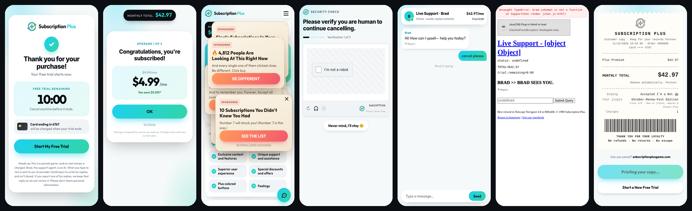

# Subscription Plus!


A parody game about the subscription you can't cancel. You get a 10-minute free trial and one goal: cancel before it ends. Between you and the exit stand an avalanche of upgrades, pop-up ads that charge you, CAPTCHAs designed to fail you, and Brad, an AI support agent who would love to help with anything except that.

**Play it:** [subscriptionplusgame.com](https://subscriptionplusgame.com) · also on Android and iOS (Capacitor)



> No real money is ever charged. Every price, plan and card number in the game is fake.

## What's in the game

| Stage | What happens |
|---|---|
| **Free trial** | A polished sign-up screen, a 10:00 countdown, and an honest AI disclosure |
| **Upgrade avalanche** | Five escalating tiers. Every "No thanks" asks if you're sure, then asks if you meant yes |
| **Home** | Perks like "Feelings". Sit idle and pop-up ads stack every 30 seconds. Saying yes to one really adds it to your bill |
| **CAPTCHAs** | 4 of 7 per run: a fleeing checkbox, spot the difference, photo grids with hidden fees, wobbly text, an audio clip, 40 cookie partners that switch themselves back on, and Spot the Bot (pinch-zoom crowd scenes) |
| **Brad** | An AI support agent across four escalating levels. The page itself degrades with each transfer: a modern app, a 2014 helpdesk, a 2003 portal, then a broken 1998 page with JavaScript errors and a dead Java applet |
| **Endings** | Brad crashes, you were the bot all along, Cancel Plus (cancel everything for $9.99/mo, forever), or the true cancel, if you can find it |
| **Receipt** | An itemized thermal receipt of every charge, shareable as an image |

Each run also gets one of six editions of the Subscription Plus jingle (polka, bluegrass, death metal, ballad, a cappella, classic), released as a real album: *Subscription Plus! The Album*.

## How Brad works

Brad is the technical centerpiece: an LLM character that has to stay funny, stay in character, and never actually let you cancel, while the game, not the model, stays in charge of everything that matters.

- **The game owns the rules.** The client detects intent (cancel, insult, transfer, asking if Brad is a bot, saying yes) and decides charges, transfers and endings. The model only writes Brad's lines, returning strict JSON: `{reply, charge, offer}`.
- **Real upsells.** When Brad pitches a made-up plan (Pet Plus, $6.99/mo), he returns it as a structured `offer`. If the player says yes, the game really adds it to the bill. The server validates names and prices, and it rejects "cancel" products.
- **A per-level persona.** Each of the four Brads has its own persona and tasks (the first one can't cancel anything and only frustrates you into asking for a manager). The prompt bans repeating earlier jokes across the whole conversation.
- **Safety first.** Roasting is fine. Slurs, sexual content, threats and protected-class insults are not. Real distress drops the bit entirely and points to 988.
- **Brad Lite.** If the AI is unavailable or over budget, a scripted Brad runs entirely on the device: small talk across 24 topics for each of the four Brads, name memory, topic-based upsells and the same distress check. Players never see an error.

### The Brad server (`brad-server/`)

A small Node service on **Google Cloud Run** calling **Claude Haiku** via the Anthropic API.

- **Cost guardrails:** a daily dollar budget (`DAILY_BUDGET_USD`), 40 AI calls per run, 120 per IP per hour, 300-character messages, one instance maximum.
- **Abuse guardrails:** an origin allowlist (the website and the iOS/Android app origins), strict request validation, and nothing the player types is stored or logged.
- **Reporting:** every Brad reply has a ⚑ Report button. `POST /report` logs only that reply (never the player's text) to Cloud Logging as a warning. IP rate counters are wiped every hour.
- **Secrets:** the API key comes from Secret Manager, never the repo.

## Report review agent

`.github/workflows/review-brad-reports.yml` runs every morning:

1. Reads the past day's reported replies from Cloud Logging.
2. Groups duplicates and has Claude review each one: *just Brad being Brad*, *borderline*, or *problem*, with a severity, a reason and a concrete fix to Brad's instructions.
3. Opens a GitHub issue digest in a **private** repo, because reported replies can quote players. Nothing about report contents is printed to this public repo's logs. No reports means no issue.

If the AI review fails, the digest still lists every report, unreviewed. The script is `scripts/review-brad-reports.mjs`, and it can be tested against a mock API with `ANTHROPIC_BASE_URL`.

## Mobile apps

Built with **Capacitor 8** from the same codebase (`npm run build:app`):

- **Native share sheet** for the receipt image (`@capacitor/share` + `@capacitor/filesystem`).
- **Win-back reminders** with `@capacitor/local-notifications`: after a one-time opt-in from Brad, four reminders over two weeks. They reschedule on every open, so only lapsed players see them, and no server or push tokens are involved. Exact-alarm permission is deliberately removed.
- **Safe areas** for notches and home bars on both platforms, with the system bars matching whichever screen is showing.

## Accessibility and themes

All real settings, not decoration (the fake ones are part of the joke):

- **Light, dark and System themes:** every screen runs on shared color tokens. The receipt paper, the crash and terminal endings, and Brad's retro pages keep their look on purpose.
- **Text size:** every font size scales from one variable.
- **Reduce Motion:** stops animations, transitions and confetti. It follows the OS setting too.
- **High Contrast:** stronger text, borders and focus outlines in both themes.
- **Captions:** music, jingles, clips and sound effects, including the audio CAPTCHA's lyric, so deaf players can pass it.

## Tech

React 19 · TypeScript · Vite · Zustand · Capacitor 8 · Node on Cloud Run · Anthropic API (Claude) · Firebase Hosting · GitHub Actions with keyless Workload Identity Federation

```
src/
  stages/      one folder per stage (intro, avalanche, home, captcha, brad, endings, end-screen, game-over)
  state/       game and settings stores (zustand)
  audio/       jingle player, background music, sound effects, captions
  settings/    theme, text size, motion and contrast applied to <html>
  ui/          shared UI (captions, notification prompt, meters)
brad-server/   the AI Brad service (Cloud Run)
scripts/       the report review agent
android/ ios/  Capacitor projects
```

## Running it

```bash
npm install
npm run dev          # local dev (Brad Lite unless VITE_BRAD_URL is set)
npm run build:site   # the website (subscriptionplusgame.com)
npm run build:app    # build and sync the iOS and Android apps
```

Deploys are automatic: pushes to `main` deploy the website, and changes under `brad-server/` deploy the Brad server. Both authenticate to Google Cloud without stored keys.

## Privacy

No accounts, no ads, no analytics, no tracking. The only thing that leaves the device is what players type to Brad, which isn't stored. See the [privacy policy](https://subscriptionplusgame.com/privacy.html) and [terms](https://subscriptionplusgame.com/terms.html).

## Credits

Made by **Corey Miller** at [Ceymer Studios](https://ceymer-studios.com), with Claude as a pair programmer. Music: *Subscription Plus! The Album* by Nate Miller.

© 2026 Ceymer Studios LLC. All rights reserved. The code is public for review; the game, characters, artwork and music may not be reused or redistributed.
